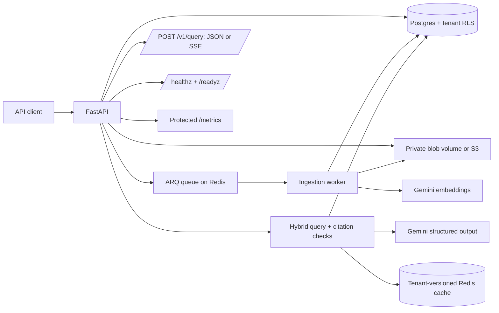

# Enterprise RAG Platform

Foundation for a multi-tenant document question-answering service. The current implementation provides the FastAPI process, PostgreSQL schema with tenant RLS, hashed API-key authentication, Redis-backed rate limiting and ingestion jobs, protected metrics, health routes, private PDF ingestion, page-aware chunking, Gemini embeddings, quarantine review, and a local API/worker container workflow. Milestone 4 adds tenant-scoped hybrid retrieval, guarded Gemini answers, citation validation, SSE and a versioned answer cache. The web UI remains a later milestone.

## Contents

- [Requirements](docs/REQUIREMENTS.md)
- [API contract and endpoint catalog](docs/API_DESIGN.md)
- [Architecture](docs/ARCHITECTURE.md)
- [Architecture decisions](docs/ADR/README.md)
- [Glossary](docs/GLOSSARY.md)
- [Traceability](docs/TRACEABILITY.md)
- [UX outline](docs/UX.md)

## Requirements and API

The approved Phase 0 design proposes p95 non-LLM API latency ≤300 ms, p95 answer first-token latency ≤3 s, monthly API availability ≥99.5%, and 80% test coverage. Quantitative service goals remain owner-confirmation proposals. The versioned API source is [api/openapi.yaml](api/openapi.yaml); health routes are `/healthz` and `/readyz`. See the [API design](docs/API_DESIGN.md) for authentication, SSE and error conventions.

## Architecture



The API follows a hexagonal package layout under `src/rag`: transport in `api`, validated settings and logging in `core`, application composition in `composition.py`, persistence and Redis adapters, and tenant/auth policies in domain and services.

## Quickstart

Prerequisites: Python 3.12 and [uv](https://docs.astral.sh/uv/); Docker Engine with Compose is optional.

```powershell
uv sync --all-groups
docker compose up -d db state cache
make migrate
docker compose up --build api worker
```

To provision a first local tenant and its one-time admin credential, run `make bootstrap TENANT_NAME="Example tenant"` after migrations. Store the emitted API key securely; it is shown once and cannot be retrieved later. The local migrator profile uses the privileged database role and must only be run by a trusted operator.

In another terminal, `make smoke` checks liveness and readiness. Or run `docker compose up --build` and open `http://127.0.0.1:8000/healthz`. `/metrics` returns 403 until `METRICS_SCRAPE_TOKEN` is set to a random value of at least 32 characters and supplied as a Bearer token. Local Postgres uses trust authentication only on an unexposed internal Compose network; production must use managed credentials and separate runtime/migration roles.

## Configuration

| Variable | Default | Purpose |
|---|---|---|
| `APP_NAME` | `enterprise-rag-api` | Service title and structured configuration. |
| `APP_ENV` | `development` | Environment: development, test, staging, production. |
| `LOG_LEVEL` | `INFO` | Minimum structured log level. |
| `METRICS_SCRAPE_TOKEN` | unset | Strong bearer secret required for `/metrics`; unset denies access. |
| `DATABASE_URL` | Compose local runtime URL | Runtime Postgres connection using a non-owner role. |
| `MIGRATION_DATABASE_URL` | Compose local migration URL | Privileged one-off migration connection; never used by API request handling. |
| `REDIS_URL` | Compose local `state` URL | Redis control-state connection for distributed rate limits (`noeviction`). |
| `CACHE_REDIS_URL` | Compose local `cache` URL | Evictable query response payloads; tenant epochs remain in `state`. |
| `RATE_LIMIT_REQUESTS` | `60` | Per API key fixed-window request limit. |
| `RATE_LIMIT_WINDOW_SECONDS` | `60` | Shared rate-limit window length. |
| `RATE_LIMIT_MEMORY_FALLBACK_REQUESTS` | `10` | Stricter per-process limit used if Redis is unavailable. |
| `RATE_LIMIT_MEMORY_FALLBACK_WINDOW_SECONDS` | `60` | Local fallback window length. |
| `BLOB_BACKEND` | `local` | `local` shared volume for Compose or `s3` for private S3-compatible object storage. |
| `BLOB_LOCAL_ROOT` | `/var/lib/rag/blobs` | Local private volume root shared by API and worker. |
| `BLOB_BUCKET`, `BLOB_ENDPOINT_URL`, `BLOB_REGION` | local bucket, empty endpoint, `us-east-1` | Private S3-compatible target; production endpoint must use HTTPS. |
| `BLOB_ACCESS_KEY_ID`, `BLOB_SECRET_ACCESS_KEY` | unset | Optional S3 credentials; prefer workload identity where available. |
| `BLOB_MAX_UPLOAD_BYTES`, `BLOB_MAX_PAGES` | `104857600`, `250` | Upload and PDF extraction bounds. |
| `INGESTION_MAX_QUEUE_SIZE`, `INGESTION_MAX_CONCURRENCY` | `500`, `2` | Per-tenant queue admission bound and worker concurrency. |
| `INGESTION_CHUNK_CHARS`, `INGESTION_CHUNK_OVERLAP_CHARS` | `2400`, `300` | Deterministic page-aware chunk sizes. |
| `EMBEDDING_API_KEY` | unset | Gemini API secret; required by the worker outside test/local startup. |
| `EMBEDDING_MODEL`, `EMBEDDING_DIMENSIONS`, `EMBEDDING_TIMEOUT_SECONDS` | `gemini-embedding-2`, `768`, `20` | Proposed embedding defaults; confirm with owner before production. |
| `GENERATION_MODEL`, `GENERATION_TIMEOUT_SECONDS` | `gemini-3.8-flash`, `20` | Proposed Gemini generation model and provider timeout; owner confirmation required. |
| `GENERATION_MAX_OUTPUT_TOKENS`, `GENERATION_MAX_CONCURRENCY` | `1024`, `8` | Bounded answer output and concurrent generation calls. |
| `QUERY_CONTEXT_TOKEN_BUDGET`, `QUERY_MINIMUM_SIMILARITY` | `6000`, `0.35` | Proposed context and dense-retrieval thresholds; confirm with owner and evaluate. |
| `QUERY_CACHE_TTL_SECONDS` | `300` | Maximum successful answer-cache lifetime; tenant epoch invalidates changed knowledge bases. |
Copy `.env.example` to `.env` for local changes. Never commit `.env`.

Compose runs the separate `cache` Redis service with a 128 MiB cap and `allkeys-lru`. Query payloads use `cache`; tenant invalidation epochs use `state`. Local uploads and worker downloads use temporary space capped at 256 MiB; production ingress should also enforce the upload request-body limit.

## Tooling

`make setup`, `make dev`, `make test`, `make lint`, `make typecheck`, `make migrate`, `make smoke`, and `make security-audit` are active. Coverage gate is 80%. `eval`, `redteam`, `load-test`, and Terraform targets remain unavailable until their milestones. CI runs lint, strict typing, tests, secret scan, dependency audit, and a container build. GitHub Actions use pinned commit SHAs and minimal permissions.

## Security and operations

The metrics endpoint is token-protected and should also be network-restricted by deployment configuration. Request IDs are bounded to a safe character set or regenerated. Logs omit request bodies, query strings, credentials and user identifiers. Liveness checks only the process. Readiness checks Postgres, the shared rate-limit store, and ingestion queue. Quarantine content is returned as plain text to authorized admins; clients must never interpret it as HTML. The scanner is heuristic and does not replace guarded-RAG safety rules in the approved architecture.

The container runs as non-root, drops Linux capabilities in Compose, uses a read-only root filesystem, and has a liveness health check. The Python base image and local database/Redis images are pinned by immutable digests. See [architecture](docs/ARCHITECTURE.md) and the [decision records](docs/ADR/README.md).

