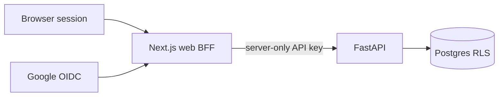
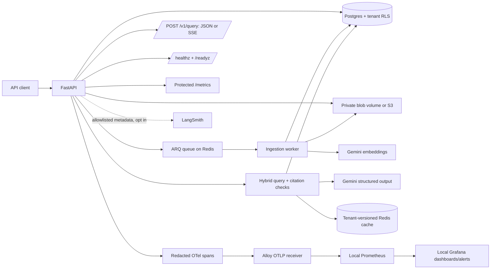
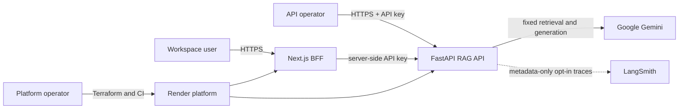
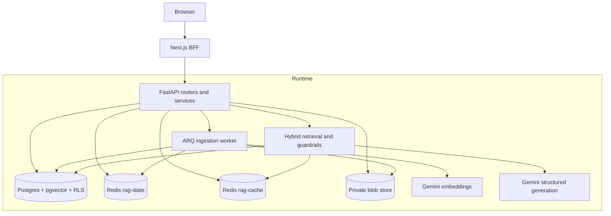
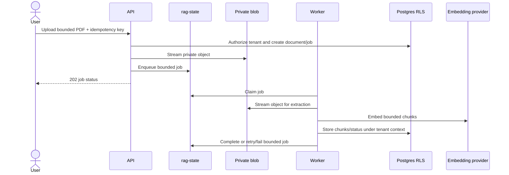
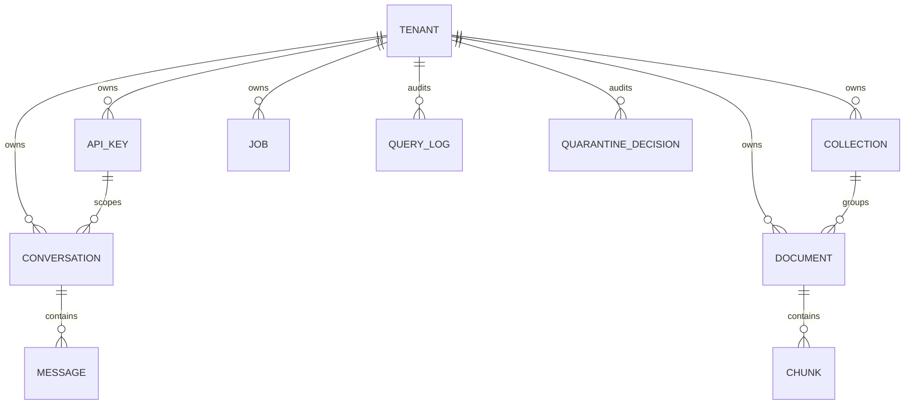
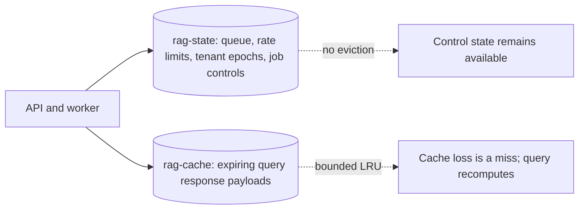
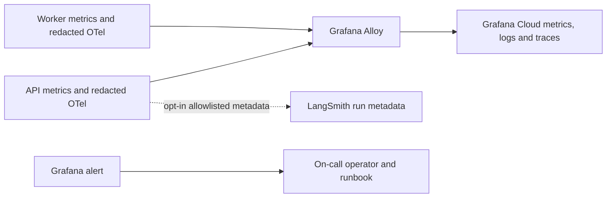
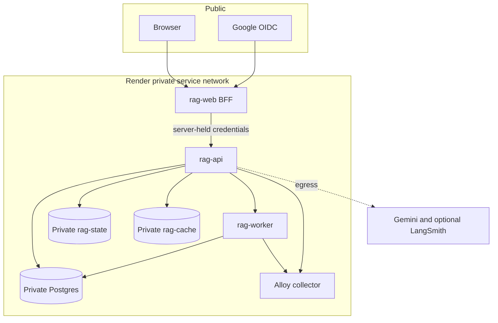
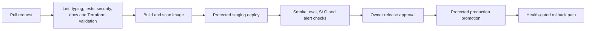

# Enterprise Hybrid RAG & LLLOps gateway  Platform

Foundation for a multi-tenant document question-answering service. The current implementation provides FastAPI, PostgreSQL tenant RLS, hashed API-key authentication, Redis-backed rate limiting and ingestion jobs, protected metrics, private PDF ingestion, hybrid retrieval, guarded answers with citations, SSE, evaluations, security controls, and Render/Grafana Terraform. Milestone 8 adds the Next.js workspace with Google OIDC, a server-side BFF, streaming chat, knowledge management, and role-gated admin screens. No paid resources have been created because owner account, region, plans, budget, remote state, and provider values are not configured.

## Contents

- [Requirements](docs/REQUIREMENTS.md)
- [API contract and endpoint catalog](docs/API_DESIGN.md)
- [Architecture](docs/ARCHITECTURE.md)
- [Architecture decisions](docs/ADR/README.md)
- [Glossary](docs/GLOSSARY.md)
- [Traceability](docs/TRACEABILITY.md)
- [UX outline](docs/UX.md)
- [Evaluation guide](docs/EVALUATION.md)
- [AI security and threat mapping](docs/AI_SECURITY.md)
- [SLOs and operations](docs/SLO.md)
- [Production readiness and release decision](docs/PRODUCTION_READINESS.md)
- [Technical debt](docs/TECH_DEBT.md)
- [Contributing](CONTRIBUTING.md)
- [Changelog](CHANGELOG.md)

## Requirements and API

The Phase 0 design proposes p95 non-LLM API latency <=300 ms, p95 answer first-token latency <=3 s, monthly API availability >=99.5%, and 80% test coverage. Targets remain owner-confirmation proposals and staging measurements are not available. The versioned API source is [api/openapi.yaml](api/openapi.yaml); health routes are `/healthz` and `/readyz`. See the [API design](docs/API_DESIGN.md) for authentication, SSE and error conventions.

## Web workspace

The `web/` application is a Next.js App Router workspace in English and Swahili. It includes Google sign-in, streaming chat with citations, conversation history, collection and PDF management, and role-gated administration. The browser calls the same-origin Next.js BFF; only the BFF reads the server-side identity mapping and attaches an API key.



Local startup: copy `web/.env.example` to `web/.env.local`, set an Auth.js secret, Google OAuth credentials, and a local identity mapping that points to an API key with the correct tenant role; then run `npm ci --ignore-scripts` and `npm run dev` from `web/`. Keep that identity mapping and API key in ignored local secrets. The web container is also included in `docker compose up --build`; open `http://127.0.0.1:3001`.

The `rag-web` Render service is opt-in in the staging Terraform workflow. It requires web origin/API URL variables plus protected `TERRAFORM_WEB_SECRETS_JSON` with `AUTH_SECRET`, Google OAuth values, and the approved email-to-API-key identity map. The web service does not receive API provider/storage environment-group secrets. See [ADR-018](docs/ADR/ADR-018-milestone-8-web-workspace.md) and the [UX specification](docs/UX.md). UI screenshots are a release artifact after a non-production Google test identity and staging URL are configured; do not add customer data or bypass authentication to create them.

## Architecture



The API follows a hexagonal package layout under `src/rag`: transport in `api`, validated settings and logging in `core`, application composition in `composition.py`, persistence and Redis adapters, and tenant/auth policies in domain and services.

## Quickstart

Prerequisites: Python 3.12 and [uv](https://docs.astral.sh/uv/); Docker Engine with Compose is optional.

```powershell
uv sync --all-groups
docker compose up -d db state cache
make migrate
docker compose up --build api worker
```

To provision a first local tenant and its one-time admin credential, run `make bootstrap TENANT_NAME="Example tenant"` after migrations. Store the emitted API key securely; it is shown once and cannot be retrieved later. The local migrator profile uses the privileged database role and must only be run by a trusted operator.

In another terminal, `make smoke` checks liveness and readiness. Or run `docker compose up --build` and open `http://127.0.0.1:8000/healthz`. `/metrics` returns 403 until `METRICS_SCRAPE_TOKEN` is set to a random value of at least 32 characters and supplied as a Bearer token. Local Postgres uses trust authentication only on an unexposed internal Compose network; production must use managed credentials and separate runtime/migration roles.

## Configuration

| Variable | Default | Purpose |
|---|---|---|
| `APP_NAME` | `enterprise-rag-api` | Service title and structured configuration. |
| `RELEASE_VERSION` | `unknown` | Release label included in redacted telemetry; CI/deploy should set a commit or release identifier. |
| `APP_ENV` | `development` | Environment: development, test, staging, production. |
| `LOG_LEVEL` | `INFO` | Minimum structured log level. |
| `METRICS_SCRAPE_TOKEN` | unset | Strong bearer secret required for `/metrics`; unset denies access. |
| `OTEL_EXPORTER_OTLP_ENDPOINT` | unset | Optional OTLP/HTTP trace endpoint; local profile uses `http://alloy:4318/v1/traces`. |
| `LANGSMITH_TRACING` | `false` | Opt in to metadata-only LangSmith runs; exporter does not receive prompts or outputs. |
| `LANGSMITH_API_KEY` | unset | LangSmith key, required only when tracing is enabled. |
| `LANGSMITH_PROJECT`, `LANGSMITH_ENDPOINT`, `LANGSMITH_SAMPLE_RATE` | `rag-development`, unset, `1.0` | Environment-scoped project, optional regional endpoint and bounded sampling fraction. Confirm region/retention with owner. |
| `AI_INPUT_PII_ACTION` | `flag` | `flag`, `redact`, or `block` common email/credential-shaped query input; proposed default needs owner confirmation. |
| `GENERATION_ENABLED` | `true` | Set false to disable generation while query requests return a safe refusal. |
| `WORKER_METRICS_PORT` | `9000` | Internal worker Prometheus endpoint; bind only on the private service network. |
| `DATABASE_URL` | Compose local runtime URL | Runtime Postgres connection using a non-owner role. |
| `MIGRATION_DATABASE_URL` | Compose local migration URL | Privileged one-off migration connection; never used by API request handling. |
| `REDIS_URL` | Compose local `state` URL | Redis control-state connection for distributed rate limits (`noeviction`). |
| `CACHE_REDIS_URL` | Compose local `cache` URL | Evictable query response payloads; tenant epochs remain in `state`. |
| `RATE_LIMIT_REQUESTS` | `60` | Per API key fixed-window request limit. |
| `RATE_LIMIT_WINDOW_SECONDS` | `60` | Shared rate-limit window length. |
| `RATE_LIMIT_MEMORY_FALLBACK_REQUESTS` | `10` | Stricter per-process limit used if Redis is unavailable. |
| `RATE_LIMIT_MEMORY_FALLBACK_WINDOW_SECONDS` | `60` | Local fallback window length. |
| `BLOB_BACKEND` | `local` | `local` shared volume for Compose or `s3` for private S3-compatible object storage. |
| `BLOB_LOCAL_ROOT` | `/var/lib/rag/blobs` | Local private volume root shared by API and worker. |
| `BLOB_BUCKET`, `BLOB_ENDPOINT_URL`, `BLOB_REGION` | local bucket, empty endpoint, `us-east-1` | Private S3-compatible target; production endpoint must use HTTPS. |
| `BLOB_ACCESS_KEY_ID`, `BLOB_SECRET_ACCESS_KEY` | unset | Optional S3 credentials; prefer workload identity where available. |
| `BLOB_MAX_UPLOAD_BYTES`, `BLOB_MAX_PAGES` | `104857600`, `250` | Upload and PDF extraction bounds. |
| `INGESTION_MAX_QUEUE_SIZE`, `INGESTION_MAX_CONCURRENCY` | `500`, `2` | Per-tenant queue admission bound and worker concurrency. |
| `INGESTION_CHUNK_CHARS`, `INGESTION_CHUNK_OVERLAP_CHARS` | `2400`, `300` | Deterministic page-aware chunk sizes. |
| `EMBEDDING_API_KEY` | unset | Gemini API secret; required by the worker outside test/local startup. |
| `EMBEDDING_MODEL`, `EMBEDDING_DIMENSIONS`, `EMBEDDING_TIMEOUT_SECONDS` | `gemini-embedding-2`, `768`, `20` | Proposed embedding defaults; confirm with owner before production. |
| `GENERATION_MODEL`, `GENERATION_TIMEOUT_SECONDS` | `gemini-3.8-flash`, `20` | Proposed Gemini generation model and provider timeout; owner confirmation required. |
| `GENERATION_MAX_OUTPUT_TOKENS`, `GENERATION_MAX_CONCURRENCY` | `1024`, `8` | Bounded answer output and concurrent generation calls. |
| `QUERY_CONTEXT_TOKEN_BUDGET`, `QUERY_MINIMUM_SIMILARITY` | `6000`, `0.35` | Proposed context and dense-retrieval thresholds; confirm with owner and evaluate. |
| `QUERY_CACHE_TTL_SECONDS` | `300` | Maximum successful answer-cache lifetime; tenant epoch invalidates changed knowledge bases. |
Copy `.env.example` to `.env` for local changes. Never commit `.env`.

For local dashboards, set `OTEL_EXPORTER_OTLP_ENDPOINT=http://alloy:4318/v1/traces` and run `docker compose --profile observability up --build`. Grafana is at `http://127.0.0.1:3000` (local admin password defaults to a public development-only value; override `GRAFANA_ADMIN_PASSWORD`). Prometheus is at `http://127.0.0.1:9090`. Local Alloy exports traces to its bounded debug sink; customer or production trace payloads must not be used. Grafana/Prometheus/Alloy image tags are version-pinned; digest pinning remains a deployment follow-up.

Compose runs the separate `cache` Redis service with a 128 MiB cap and `allkeys-lru`. Query payloads use `cache`; tenant invalidation epochs use `state`. Local uploads and worker downloads use temporary space capped at 256 MiB; production ingress should also enforce the upload request-body limit.

## Tooling

`make setup`, `make dev`, `make test`, `make lint`, `make typecheck`, `make migrate`, `make smoke`, `make security-audit`, `make redteam`, `make load-test`, and `make eval` are active. `make redteam` uses synthetic provider-free cases. `make load-test` requires explicit staging URL/API key/collection UUID environment variables and never runs against production by default. `make eval` requires an explicitly configured non-production benchmark API, admin key, collection and Gemini judge credentials; it records a baseline until the owner approves numeric thresholds. Coverage gate is 80%. `make tf-plan` uses the configured remote backend and `make tf-apply` refuses local applies. CI runs lint, strict typing, tests, red-team smoke, secret scan, dependency audit, and a container build. GitHub Actions use pinned commit SHAs and minimal permissions.

## Security and operations

The metrics endpoint is token-protected and should also be network-restricted by deployment configuration. Request IDs are bounded to a safe character set or regenerated. Logs omit request bodies, query strings, credentials and user identifiers. Traces use route templates and status only. LangSmith is disabled by default and receives allowlisted request metadata only. Liveness checks only the process. Readiness checks Postgres, the shared rate-limit store, and ingestion queue. Quarantine content is returned as plain text to authorized admins; clients must never interpret it as HTML. The scanner is heuristic and does not replace guarded-RAG safety rules in the approved architecture. See [AI security](docs/AI_SECURITY.md), [SLOs](docs/SLO.md) and the [incident runbook](docs/RUNBOOK_AI_INCIDENTS.md).

The container runs as non-root, drops Linux capabilities in Compose, uses a read-only root filesystem, and has a liveness health check. The Python base image and local database/Redis images are pinned by immutable digests. See [architecture](docs/ARCHITECTURE.md) and the [decision records](docs/ADR/README.md).

## Architecture diagrams

The following diagrams describe the current repository and deployment intent. External provider and Render boxes are integration boundaries; the M9 review did not verify a live deployment.

### System context (C4 level 1)



### Containers and components (C4 level 2)



### Ingestion sequence



### Query sequence and fallback behavior

```mermaid
sequenceDiagram
  actor U as User
  participant B as Next.js BFF
  participant A as FastAPI
  participant R as rag-cache
  participant D as Postgres RLS
  participant G as Gemini
  participant L as LangSmith opt-in
  U->>B: Query over same-origin session
  B->>A: Authenticated request + tenant-scoped identity
  A->>D: Tenant-filtered hybrid retrieval
  A->>R: Read tenant and epoch-scoped response cache
  alt Cache hit
    R-->>A: Valid cached safe response
  else Cache miss or cache unavailable
    A->>G: Bounded structured generation
    G-->>A: Untrusted model output
    A->>A: Validate schema, citations, safety and sanitize
  end
  A-->>B: Versioned SSE events or problem details
  B-->>U: Same-origin streamed answer and citations
  opt Tracing enabled
    A-->>L: Allowlisted metadata; no prompt/output/PII
  end
```

### Data model



### Redis separation



### Monitoring and observability



### Deployment and trust boundaries



### CI/CD flow



## Principles and controls

### AI system design principles

| Principle | Implementation/enforcement | Evidence |
|---|---|---|
| 1. Grounding over fluency | Retrieve tenant-authorized evidence, verify citations, refuse below thresholds | `src/rag/services/query.py`, [ADR-003](docs/ADR/ADR-003-hybrid-retrieval.md) |
| 2. Deterministic scaffolding | Validate structured output and citations; keep business rules in code | `src/rag/services/query.py`, `src/rag/core/config.py` |
| 3. Evaluation-driven development | Synthetic recall/ranking/citation evaluation; merge thresholds await owner | [Evaluation guide](docs/EVALUATION.md), `tests/eval/` |
| 4. Observability by default | Redacted request/job metrics and OTel; full staging trace path remains unverified | `src/rag/core/telemetry.py`, `observability/`, [TD-015](docs/TECH_DEBT.md#technical-debt-and-release-gates) |
| 5. Model and provider agnosticism | Provider integrations use ports and adapters | `src/rag/domain/ports/`, `src/rag/adapters/`, [ADR-008](docs/ADR/ADR-008-gemini-guarded-rag.md) |
| 6. Version everything | Release version and prompt/model/config metadata are emitted where implemented; embedding/index/data lineage completeness remains open | `src/rag/core/config.py`, [technical debt](docs/TECH_DEBT.md) |
| 7. Safe re-indexing | No blue/green index procedure is implemented or verified yet | [Technical debt](docs/TECH_DEBT.md#known-limitations) |
| 8. Graceful degradation | Cache fallback, bounded retries and provider error mapping; fallback behavior is covered by service tests | `src/rag/services/resilience.py`, `src/rag/services/query.py` |
| 9. Cost and latency constraints | Context/output/concurrency bounds and tenant usage summaries; spend caps and SLOs await owner/staging | `src/rag/core/config.py`, [SLOs](docs/SLO.md) |
| 10. Retrieval/generation separation | Retrieval and provider ports are independently called and evaluated | `src/rag/services/query.py`, `src/rag/domain/ports/query.py` |
| 11. Defense in depth | Tenant filters, forced RLS, scoped credentials and safe rendering | `src/rag/db/migrations/`, `web/src/`, [AI security](docs/AI_SECURITY.md) |
| 12. Data quality | Page-aware extraction, deterministic chunking and synthetic evaluation exist; representative quality baseline is pending | `src/rag/services/ingestion.py`, [Evaluation](docs/EVALUATION.md) |
| 13. Human feedback loops | Feedback endpoint and quarantine decisions are persisted; feedback-to-evaluation workflow remains an operator task | `src/rag/api/routers/`, [API design](docs/API_DESIGN.md) |
| 14. Idempotency, async and backpressure | Idempotent upload/job handling, bounded queue and worker processing | `src/rag/services/ingestion.py`, `src/rag/workers/`, [ADR-004](docs/ADR/ADR-004-worker-queue.md) |
| 15. Privacy by design | Tenant isolation, redaction and deletion controls; provider region/retention await owner decision | `src/rag/security/privacy.py`, [AI security](docs/AI_SECURITY.md) |
| 16. Progressive complexity | Fixed v1 pipeline; new retrieval components require evaluation and an ADR | [ADR index](docs/ADR/README.md), [Evaluation](docs/EVALUATION.md) |
| 17. Config-driven experimentation | Thresholds/models use validated settings; A/B and shadow evaluation are not implemented | `src/rag/core/config.py`, [technical debt](docs/TECH_DEBT.md) |

### Software engineering principles

| Principle | Enforcement | Location/check |
|---|---|---|
| Hexagonal layering | Import-linter contracts | `pyproject.toml`, `uv run lint-imports` |
| Single responsibility and dependency inversion | Services depend on domain ports; adapters implement them | `src/rag/domain/ports/`, `src/rag/adapters/` |
| KISS/YAGNI | Fixed pipeline; avoid speculative agent abstractions | [Architecture](docs/ARCHITECTURE.md) |
| Typed boundaries | Pydantic v2, mypy strict, TypeScript strict | `src/rag/api/`, `web/tsconfig.json`, CI |
| Fail-fast and stable errors | Validated settings and RFC 9457 problem details | `src/rag/core/config.py`, `src/rag/core/errors.py` |
| Bounded resources | Upload, page, queue, concurrency, token, request and pagination limits | `src/rag/core/config.py`, [requirements](docs/REQUIREMENTS.md) |
| Least privilege | Separate runtime/migrator roles, RLS and protected secrets | `scripts/postgres/init_roles.sql`, migrations, CI |
| Observable by design | Structured logs, metrics, correlation and redacted traces | `src/rag/core/`, `observability/` |
| Twelve-Factor configuration and process model | Environment-backed validated settings; stateless services and one-off migrations | `src/rag/core/config.py`, `infra/terraform/` |
| API contract and compatibility | Versioned OpenAPI and problem responses; Spectral/compatibility test evidence remains a gap | `api/openapi.yaml`, [technical debt](docs/TECH_DEBT.md) |
| Backward-compatible migrations | Alembic upgrade history; M9 metadata parity finding blocks release | `src/rag/db/migrations/`, [TD-001](docs/TECH_DEBT.md#technical-debt-and-release-gates) |
| Resilience patterns | Timeouts, bounded retry/circuit breaker policies and concurrency limits | `src/rag/services/resilience.py`, `src/rag/core/config.py` |
| Concurrency correctness | Async adapters, bounded worker concurrency and transaction scopes | `src/rag/adapters/`, `src/rag/workers/` |
| Testing pyramid and TDD | Fast provider-free behavior suite, database RLS smoke and security cases; full adapter contracts are open | `tests/`, [technical debt](docs/TECH_DEBT.md) |
| Static analysis and automatic enforcement | Ruff, strict mypy, ESLint/TypeScript, import-linter and pinned CI actions | `pyproject.toml`, `web/`, `.github/workflows/ci.yml` |
| Version control discipline | Conventional commit history, changelog and PR checks; branch protection/CODEOWNERS are owner-side gates | [CHANGELOG](CHANGELOG.md), `.github/` |
| Documentation as code | ADRs, runbooks, Markdown link/fence check in CI | `docs/`, `scripts/check_docs.py` |
| Safe delivery | Protected CI deployment intent and smoke command; staging rollout/rollback unverified | `.github/workflows/terraform-staging.yml`, [readiness](docs/PRODUCTION_READINESS.md) |
| Measure before optimizing | SLO definitions and load harness; no staging baseline is measured | [SLO](docs/SLO.md), `scripts/load_test.py` |
| Technical debt management | Prioritized risk register with evidence-based closure conditions | [Technical debt](docs/TECH_DEBT.md) |
| Supportability | Health endpoints and incident runbook; alert ownership/exercise still open | `src/rag/api/`, [runbook](docs/RUNBOOK_AI_INCIDENTS.md) |

## AI security and OWASP mapping

| Risk area | Primary control | Residual evidence/status |
|---|---|---|
| Prompt injection / untrusted context | Delimited retrieved context, fixed pipeline and output checks | [AI security mapping and tests](docs/AI_SECURITY.md); live-model resistance is not measured. |
| Sensitive information disclosure | Tenant RLS, redaction and no prompt/output trace export | Provider region and retention remain owner decisions. |
| Supply chain and insecure output handling | Lockfiles, audits, safe Markdown rendering and no model HTML insertion | Full container scan/SBOM and browser evidence remain open. |
| Excessive agency | No tools or autonomous actions in v1 | Reconfirm if scope changes through an ADR. |
| Overreliance / misinformation | Citation checks, refusal states and human review | Quality thresholds await owner approval and staging evaluation. |

The complete OWASP LLM Top 10 mapping, abuse cases and tests are in [docs/AI_SECURITY.md](docs/AI_SECURITY.md).

## Technology choices and decisions

| Technology | Purpose | Decision |
|---|---|---|
| FastAPI and Pydantic | Typed async HTTP boundary | [ADR-002](docs/ADR/ADR-002-rest-sse.md) |
| PostgreSQL and pgvector | Tenant-scoped relational, full-text and vector storage | [ADR-001](docs/ADR/ADR-001-postgres-pgvector.md) |
| Redis and ARQ | Bounded background jobs, rate limits and cache | [ADR-004](docs/ADR/ADR-004-worker-queue.md), [ADR-006](docs/ADR/ADR-006-redis-split.md) |
| Gemini behind provider ports | Embedding and structured generation | [ADR-008](docs/ADR/ADR-008-gemini-guarded-rag.md) |
| Next.js BFF and Google OIDC | Same-origin authenticated UI | [ADR-018](docs/ADR/ADR-018-milestone-8-web-workspace.md) |
| Render and Terraform | Infrastructure as code and deployment target | [ADR-010](docs/ADR/ADR-010-render-terraform.md), [ADR-017](docs/ADR/ADR-017-m7-render-grafana-infrastructure.md) |
| OpenTelemetry, Alloy, Grafana, optional LangSmith | Metrics/traces/alerts and opt-in LLM metadata | [ADR-011](docs/ADR/ADR-011-observability.md), [ADR-015](docs/ADR/ADR-015-milestone-5-observability-security.md) |

See the [ADR index](docs/ADR/README.md) for decisions and status.

## API examples

Use a non-production API key and synthetic tenant. Never commit a real key.

```bash
export RAG_API_URL="http://127.0.0.1:8000"
export RAG_API_KEY="<local-api-key>"
curl --fail-with-body -H "Authorization: Bearer $RAG_API_KEY" "$RAG_API_URL/healthz"
```

The OpenAPI contract is the source of truth for ingest, query, streaming, feedback and problem response schemas. See [api/openapi.yaml](api/openapi.yaml) and [docs/API_DESIGN.md](docs/API_DESIGN.md). Streaming uses the documented versioned SSE events; do not infer event ordering from this abbreviated quickstart.

With a local API key, a local collection and a synthetic PDF already available:

```bash
curl --fail-with-body -X POST "$RAG_API_URL/v1/documents" \
  -H "Authorization: Bearer $RAG_API_KEY" \
  -H "Idempotency-Key: local-upload-001" \
  -F "collection_id=$RAG_COLLECTION_ID" \
  -F "file=@./synthetic-handbook.pdf;type=application/pdf"

curl --fail-with-body -X POST "$RAG_API_URL/v1/query" \
  -H "Authorization: Bearer $RAG_API_KEY" -H "Content-Type: application/json" \
  -d "{\"question\":\"What does the handbook say about leave?\",\"collection_ids\":[\"$RAG_COLLECTION_ID\"]}"

curl --no-buffer -X POST "$RAG_API_URL/v1/query" \
  -H "Authorization: Bearer $RAG_API_KEY" -H "Content-Type: application/json" \
  -H "Accept: text/event-stream" \
  -d "{\"question\":\"Summarize the leave policy.\",\"collection_ids\":[\"$RAG_COLLECTION_ID\"],\"stream\":true}"

curl --fail-with-body -X POST "$RAG_API_URL/v1/feedback" \
  -H "Authorization: Bearer $RAG_API_KEY" -H "Content-Type: application/json" \
  -H "Idempotency-Key: local-feedback-001" \
  -d '{"request_id":"<request-id-from-answer>","rating":"up"}'

# Example validation error (a missing question); response is RFC 9457 problem details.
curl -i -X POST "$RAG_API_URL/v1/query" \
  -H "Authorization: Bearer $RAG_API_KEY" -H "Content-Type: application/json" \
  -d '{}'
```

Replace the example identifiers with values returned by the local API. Do not use these commands against production.

## Evaluation, deployment and operations

- Run provider-free tests and security smoke with `make test` and `make redteam`; run `make eval` only with an explicitly configured non-production benchmark. Results and limitations are in [Evaluation](docs/EVALUATION.md).
- Use `make tf-plan` only with an approved non-production remote backend and complete staging inputs. Terraform apply is CI-controlled; no staging or production plan was run in M9. See [Terraform deployment guide](infra/terraform/README.md).
- SLO definitions and measurement method are in [docs/SLO.md](docs/SLO.md). Local dashboards do not establish production alert delivery.
- Incident procedures: [AI incident runbook](docs/RUNBOOK_AI_INCIDENTS.md), [AI security](docs/AI_SECURITY.md), and [production readiness](docs/PRODUCTION_READINESS.md).
- Backup/restore, re-indexing, retention and scaling drills remain deployment gates; see [technical debt](docs/TECH_DEBT.md).

## Repository structure and delivery

```text
api/                 OpenAPI contract
docs/                Requirements, architecture, ADRs, SLO and operations
infra/               Render/Grafana Terraform and telemetry configuration
observability/       Local dashboards, alerts and collector configuration
scripts/             Smoke, load, evaluation and database role helpers
src/rag/api/         HTTP routers and boundary schemas
src/rag/domain/      Domain types and ports
src/rag/services/    Fixed RAG use cases and policies
src/rag/adapters/    Database, Redis, blob, Gemini and tracing adapters
src/rag/workers/     Background ingestion processing
tests/               Unit, security, integration and evaluation suites
web/                 Next.js BFF and workspace UI
```

The test strategy emphasizes behavior tests, provider-free unit tests, tenant isolation, red-team cases, contract checks and branch coverage. Current M9 results and gaps are in [production readiness](docs/PRODUCTION_READINESS.md). The contribution workflow is in [CONTRIBUTING.md](CONTRIBUTING.md). Roadmap and known limitations are recorded in [technical debt](docs/TECH_DEBT.md). The repository has no LICENSE file because the owner has not selected a license; public visibility does not grant reuse rights.

## Documentation validation and release status

Markdown and Mermaid changes are reviewed with `git diff --check`; a CI renderer/link checker is not yet configured, so GitHub rendering and cross-link integrity are not automatically enforced. Milestone 9 recommendation is **NO-GO** pending the gates in [docs/PRODUCTION_READINESS.md](docs/PRODUCTION_READINESS.md). No production-readiness or WCAG-conformance claim is made.

