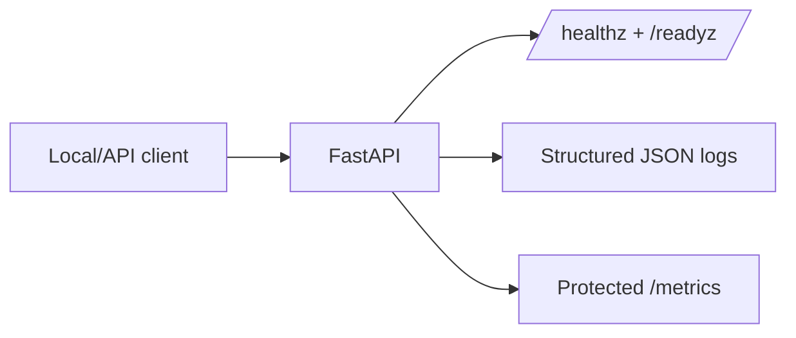

# Enterprise RAG Platform

Design-approved foundation for a multi-tenant document question-answering service. Current milestone provides the API process, validated runtime configuration, structured request logging, protected metrics, health routes, and local container workflow. Knowledge ingestion, persistence, authentication, and the web UI arrive in later approved milestones.

## Contents

- [Requirements](docs/REQUIREMENTS.md)
- [API contract and endpoint catalog](docs/API_DESIGN.md)
- [Architecture](docs/ARCHITECTURE.md)
- [Architecture decisions](docs/ADR/README.md)
- [Glossary](docs/GLOSSARY.md)
- [Traceability](docs/TRACEABILITY.md)
- [UX outline](docs/UX.md)

## Requirements and API

The approved Phase 0 design proposes p95 non-LLM API latency ≤300 ms, p95 answer first-token latency ≤3 s, monthly API availability ≥99.5%, and 80% test coverage. Quantitative service goals remain owner-confirmation proposals. The versioned API source is [api/openapi.yaml](api/openapi.yaml); health routes are `/healthz` and `/readyz`. See the [API design](docs/API_DESIGN.md) for authentication, SSE and error conventions.

## Architecture



The API follows a hexagonal package layout under `src/rag`: transport in `api`, validated settings and logging in `core`, and reserved package boundaries for domain, services, adapters and workers. Domain/application code will be introduced with the milestone that owns its behavior.

## Quickstart

Prerequisites: Python 3.12 and [uv](https://docs.astral.sh/uv/); Docker Engine with Compose is optional.

```powershell
uv sync --all-groups
uv run uvicorn rag.api.main:app --app-dir src --host 127.0.0.1 --port 8000 --reload
```

In another terminal, `make smoke` checks liveness and readiness. Or run `docker compose up --build` and open `http://127.0.0.1:8000/healthz`. `/metrics` returns 403 until `METRICS_SCRAPE_TOKEN` is set to a random value of at least 32 characters and supplied as a Bearer token.

## Configuration

| Variable | Default | Purpose |
|---|---|---|
| `APP_NAME` | `enterprise-rag-api` | Service title and structured configuration. |
| `APP_ENV` | `development` | Environment: development, test, staging, production. |
| `LOG_LEVEL` | `INFO` | Minimum structured log level. |
| `METRICS_SCRAPE_TOKEN` | unset | Strong bearer secret required for `/metrics`; unset denies access. |
Copy `.env.example` to `.env` for local changes. Never commit `.env`.

## Tooling

`make setup`, `make dev`, `make test`, `make lint`, `make typecheck`, and `make smoke` are active. Coverage gate is 80%. `migrate`, `eval`, `redteam`, `load-test`, and Terraform targets deliberately fail with an explanatory message until their milestones add the required systems. CI runs lint, strict typing, tests, secret scan, and a container build. GitHub Actions use pinned commit SHAs and minimal permissions.

## Security and operations

The metrics endpoint is token-protected and should also be network-restricted by deployment configuration. Request IDs are bounded to a safe character set or regenerated. Logs omit request bodies, query strings, credentials and user identifiers. The M1 readiness route checks only the API process because DB, queue and blob adapters are not introduced yet; M2+ must add dependency checks before declaring full readiness.

The container runs as non-root, drops Linux capabilities in Compose, uses a read-only root filesystem, and has a liveness health check. The Python base image is pinned by version tag pending a verified immutable digest in a later hardening pass. See [architecture](docs/ARCHITECTURE.md) and the [decision records](docs/ADR/README.md).

