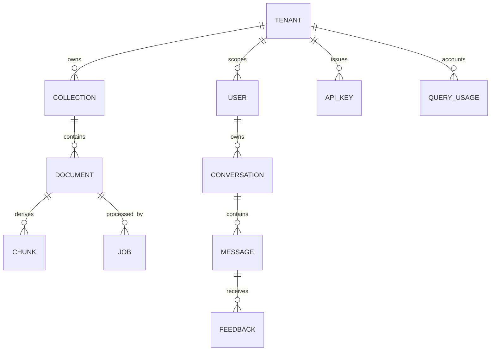
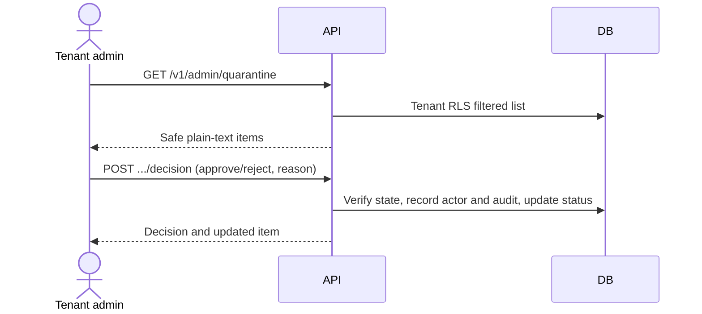

# API design

Status: proposed contract for owner review. Source of truth: [`api/openapi.yaml`](../api/openapi.yaml), OpenAPI 3.1. This contract is not implementation evidence.

## Style and resources

REST over HTTPS under `/v1`; SSE for answer streaming; `202 Accepted` plus job resource for ingestion. REST provides a simple browser/BFF and machine-client contract, generated schemas, and resource-oriented CRUD. GraphQL is not selected because the product has a bounded resource model and no demonstrated need for client-shaped joins; gRPC is not selected because public browser interoperability and inspectability are primary. See ADR-002. Long-running indexing never runs inline in the request.



## Endpoint catalog

`user session` means authenticated BFF identity; `API key` means machine client. IDs use stable authorization scopes from the OpenAPI security schemes. `K` is key-scoped, `T` tenant-scoped, and `G` global operator-only.

| Method / path | Purpose | Access | Idempotency | Request → response | Errors / rate class | FR |
|---|---|---|---|---|---|---|
| POST `/v1/documents` | Upload one PDF | editor:write | Required `Idempotency-Key` | multipart file+collection+metadata → 202 DocumentJob | 400/401/403/409/413/415/422/429/503; upload | ING-001..004, AUTH-004 |
| GET `/v1/documents` | Search/list documents | viewer:read | Safe | cursor/filter → DocumentPage | 401/403/422/429; read | KB-001, ING-002 |
| GET `/v1/documents/{document_id}` | Document details | viewer:read | Safe | path → Document | 401/403/404; read | ING-002 |
| DELETE `/v1/documents/{document_id}` | Delete + cascade | editor:write | Idempotent | path → 202 DeleteOperation | 401/403/404/429/503; write | ING-005, KB-001 |
| GET `/v1/jobs/{job_id}` | Poll ingestion/deletion job | viewer:read | Safe | path → Job | 401/403/404; read | ING-002, STA-001 |
| POST `/v1/jobs/{job_id}/retry` | Retry eligible failed job | editor:write | Required key | path → 202 Job | 401/403/404/409/429; write | ING-002 |
| DELETE `/v1/jobs/{job_id}` | Cancel queued/running job | editor:write | Idempotent | path → 202 Job | 401/403/404/409; write | QRY-003, ING-002 |
| GET `/v1/collections` | List collections | viewer:read | Safe | cursor → CollectionPage | 401/403/422; read | KB-001, QRY-001 |
| POST `/v1/collections` | Create collection | editor:write | Required key | CollectionInput → Collection | 401/403/409/422; write | KB-001 |
| GET `/v1/collections/{collection_id}` | Get collection | viewer:read | Safe | path → Collection | 401/403/404; read | KB-001 |
| PATCH `/v1/collections/{collection_id}` | Rename/update metadata | editor:write | `If-Match` recommended | CollectionPatch → Collection | 401/403/404/409/422; write | KB-001 |
| DELETE `/v1/collections/{collection_id}` | Delete collection and content | editor:write | Idempotent | path → DeleteOperation | 401/403/404/409; write | KB-001, ING-005 |
| POST `/v1/query` | Query and stream or return answer | viewer:read | Safe (not guaranteed replay) | QueryInput → QueryResult or SSE | 400/401/403/422/429/503; query | QRY-001..004, CIT-001..002, CNV-002 |
| POST `/v1/conversations` | Create conversation | viewer:read | Required key | ConversationInput → Conversation | 401/403/422/429; write | CNV-001 |
| GET `/v1/conversations` | List/search history | viewer:read | Safe | cursor/search → ConversationPage | 401/403/422; read | CNV-001 |
| GET `/v1/conversations/{conversation_id}` | Read conversation | viewer:read | Safe | path → Conversation | 401/403/404; read | CNV-001 |
| PATCH `/v1/conversations/{conversation_id}` | Rename/pin | viewer:read | `If-Match` recommended | ConversationPatch → Conversation | 401/403/404/422; write | CNV-001 |
| DELETE `/v1/conversations/{conversation_id}` | Delete conversation/messages | viewer:read | Idempotent | path → 204 | 401/403/404; write | CNV-001/002 |
| GET `/v1/conversations/{conversation_id}/messages` | Page message history | viewer:read | Safe | cursor → MessagePage | 401/403/404/422; read | CNV-002 |
| POST `/v1/feedback` | Rate answer | viewer:read | Required key | FeedbackInput → Feedback | 401/403/404/409/422/429; write | FBK-001 |
| GET `/v1/admin/quarantine` | List quarantined chunks | tenant admin | Safe | cursor/filter → QuarantinePage | 401/403/422; admin | ADM-001 |
| GET `/v1/admin/quarantine/{chunk_id}` | Inspect safe plain-text chunk | tenant admin | Safe | path → QuarantineItem | 401/403/404; admin | ADM-001 |
| POST `/v1/admin/quarantine/{chunk_id}/decision` | Approve/reject | tenant admin | Required key | DecisionInput → QuarantineDecision | 401/403/404/409/422; admin | ADM-001 |
| GET `/v1/admin/usage` | Usage/cost summary | tenant admin | Safe | bounded dates/cursor → UsageSummary | 401/403/422; admin | ADM-002, USG-001 |
| GET `/v1/admin/api-keys` | List key metadata | tenant admin | Safe | cursor → ApiKeyPage | 401/403/422; admin | ADM-002, AUTH-001 |
| POST `/v1/admin/api-keys` | Issue scoped key (shown once) | tenant admin | Required key | ApiKeyInput → ApiKeyCreated | 401/403/409/422; admin | AUTH-001, ADM-002 |
| DELETE `/v1/admin/api-keys/{key_id}` | Revoke key | tenant admin | Idempotent | path → 204 | 401/403/404; admin | AUTH-001 |
| GET `/v1/admin/status` | Tenant-visible service status | tenant admin | Safe | none → Status | 401/403/503; admin | ADM-002, STA-001 |
| GET `/healthz` | Liveness | internal/edge probe | Safe | none → Health | 200/503; probe | STA-001 |
| GET `/readyz` | Dependency readiness | internal/edge probe | Safe | none → Readiness | 200/503; probe | STA-001 |
| GET `/metrics` | Prometheus exposition | private/authenticated scrape | Safe | none → text exposition | 403; internal | STA-001/002 |
| GET `/v1/version` | Release/schema metadata | viewer:read | Safe | none → Version | 401/403; read | STA-001 |

## Request/response schemas and examples

The OpenAPI file defines every JSON operation body and response component. Common response envelopes include RFC 9457 `Problem`; paged lists include `items`, opaque `next_cursor`, and `has_more`; writes return the resource plus `request_id`. Examples:

```json
{"question":"What does the handbook say about leave?","collection_ids":["col_01J..."],"conversation_id":"conv_01J...","stream":true,"top_k":8}
```

```json
{"answer":"Eligible staff receive...","citations":[{"chunk_id":"chk_01J...","document_id":"doc_01J...","filename":"handbook.pdf","page":12,"quote":"Eligible staff receive..."}],"refusal":null,"usage":{"input_tokens":750,"output_tokens":68,"estimated_cost_usd":0.0012},"request_id":"req_01J..."}
```

The shown values are synthetic examples. Provider `run_id` is emitted only to admin/debug-authorized consumers and may be absent when tracing is disabled or unavailable.

## SSE contract: `rag.query.v1`

Media type `text/event-stream`; each event `data` is one JSON object with `contract_version: "rag.query.v1"`, `request_id`, and event-specific fields. Normal order: `retrieval_started` → exactly one `citations` → zero or more `token` OR one `refusal` → exactly one terminal `done`. An exception after headers may emit terminal `error` instead of `done`. `done`/`error` are mutually exclusive. No events follow terminal event. `token` content is provisional until `done`; clients must not present it as a verified final answer. Citation event precedes generated tokens. `refusal` ends content and then `done`.

| Event | Required payload fields | Semantics |
|---|---|---|
| `retrieval_started` | `request_id`, `collection_ids` | Accepted and retrieval started. |
| `citations` | `citations[]` | Verified citation set for this request; may be empty. |
| `token` | `text`, `sequence` | Incremental text; strictly increasing per stream. |
| `refusal` | `code`, `message` | Insufficient evidence or policy refusal. |
| `done` | `request_id`, `usage`, `langsmith_run_id?` | Normal terminal; run ID admin-only, optional. |
| `error` | `problem` | Terminal Problem Details payload; reconnect is not a retry. |

### Milestone 4 service behavior

The M4 implementation completes structured generation and citation validation before it emits the `citations` event and answer chunks. The chunks split the validated answer for transport; they are not provider-token streaming. This preserves citation-before-answer ordering and prevents unvalidated claims from entering the stream, while putting the proposed time-to-first-token objective at risk. Staging load tests must measure this path before any latency claim.

`conversation_id` is accepted as specified, but M4 does not load conversation history or persist messages. Conversation storage and ownership flows are scheduled for Milestone 8. `debug` is honored only for admin principals; ordinary readers never receive retrieval internals. Cache hits revalidate every citation against a ready document and an eligible chunk before returning.

Reconnection: `POST /v1/query` is not automatically resumable; `Last-Event-ID` is ignored and the client must explicitly retry with a new request. `AbortController` cancels client work. Server cancellation is best effort, bounded by provider timeout. Duplicate query retries can incur cost; idempotency is not promised. Conversation history becomes available after Milestone 8. Proxy buffering must be disabled. No raw prompt or chunk text is emitted as metadata. (SSE schema is included in the OpenAPI `x-sse-contract` extension because OpenAPI 3.1 does not standardize event-stream schemas.)

## Authentication and authorization

- Machine clients send `Authorization: Bearer <api-key>`; only salted/hash representation is stored. Key scopes: `read`, `write`, `admin`. Tenant comes from the key record, never a caller-supplied tenant header.
- UI uses Google OIDC through Next.js BFF; browser receives same-origin Secure/HttpOnly/SameSite session cookie, with CSRF token/origin checks on mutations. BFF maps identity to tenant and role; backend independently validates a short-lived server-side credential.
- Role mapping: viewer reads/query/feedback; editor adds/updates/deletes knowledge resources; tenant admin additionally manages keys, usage and quarantine; platform operator is out-of-band and not exposed to tenant routes.
- Every DB transaction sets tenant and principal context locally; RLS is the second enforcement layer. Background jobs carry signed/validated tenant context and run under least-privilege DB role. No migration/admin DB credentials in request runtime.

| Resource/action | Viewer | Editor | Tenant admin | Platform operator |
|---|---:|---:|---:|---:|
| Query, read collections/documents, own conversation | Yes | Yes | Yes | Operational access only |
| Upload, collection/document write/delete | No | Yes | Yes | Operational access only |
| Feedback | Own accessible answer | Own accessible answer | Own accessible answer | No |
| Review quarantine / usage / key lifecycle | No | No | Tenant only | Cross-tenant audited break-glass |
| `/metrics`, internal status | No | No | Tenant-safe summary only | Private scrape/operator |

## HTTP conventions, limits and error model

- JSON UTF-8, HTTPS, `/v1`, opaque ULID-like public identifiers; snake_case fields; UTC RFC 3339 timestamps. Cursor pagination (default 50, max 100); documented allowlisted filters/sorts only.
- **Proposed, confirm with owner:** max upload 100 MiB; per request 1 MiB JSON; query 8,000 chars; top_k 1–20; max 3 collection IDs; 15 s regular API timeout; 60 s query stream hard deadline; 20 s provider call timeout. Confirm actual Render/proxy/provider capabilities before implementation.
- Unsafe writes require `Idempotency-Key` (32–128 printable chars), stored with tenant, route and request digest for 24 h proposed; digest mismatch returns 409. `If-Match`/ETag for edits where concurrent overwrite matters.
- Responses include `X-Request-ID`; W3C `traceparent` accepted/generated; quota responses may include `RateLimit-Limit`, `RateLimit-Remaining`, `RateLimit-Reset`, `Retry-After`. Never include secrets in headers.
- Stable errors in `Problem.code`: `authentication_required` 401, `permission_denied` 403, `not_found` 404, `validation_failed` 422, `conflict` 409, `idempotency_conflict` 409, `payload_too_large` 413, `unsupported_media_type` 415, `rate_limited` 429, `quota_exceeded` 429, `insufficient_evidence` 200/refusal payload, `dependency_unavailable` 503, `provider_timeout` 503, `job_not_retryable` 409, `internal_error` 500. Problem response includes `type`, `title`, `status`, `detail` (safe), `instance`, `code`, `request_id`, and optional field errors. No stack traces.
- Deprecation: additive changes within `/v1`; removal/semantic break requires new major API prefix and migration period. **Proposed:** minimum 90-day deprecation with `Deprecation` and `Sunset` headers, owner approval and changelog.

## Async jobs and uploads

State machine: queued → processing → ready | failed; queued/processing may become cancelled. Retry failed jobs only when classified retryable; enqueue by content digest/idempotency key to avoid duplicate effects. Job poll returns 202 while active and terminal resource after complete. Failure detail is safe and stable-coded. Cancellation cannot promise rollback after irreversible external provider calls.

Upload is `multipart/form-data`, one PDF per request. Server enforces byte ceiling while streaming to temporary object storage; checks extension, MIME and magic bytes, parses in isolated bounded worker and invokes virus-scan hook before indexing. Raw object is tenant-private. Resumable/multipart chunk upload is not included in v1; retry whole upload using an idempotency key. Final size, OCR, malware scanner and storage provider remain owner/open implementation choices. See ADR-005.

## Security by endpoint

All routes require server-side identity except health probe and private metrics. Validate identifiers, body sizes, pagination and filters; rate-limit before expensive work; bind resolved tenant to RLS transaction. Upload checks content, size, MIME and scanner. Query enforces collection ACL before ranking, token budget and tenant-scoped cache. Admin routes require role and write audit entry. Delete uses an operation state and cascade evidence. Metrics are private/authenticated and use bounded labels. Detailed threat controls are requirements FR-AUTH/ING/CIT and BRIEF §5/§5A.

## Key sequences

```mermaid
sequenceDiagram
  actor E as Editor
  participant B as BFF/API
  participant S as BlobStore
  participant Q as rag-state queue
  participant W as Worker
  participant DB as PostgreSQL/RLS
  E->>B: POST /v1/documents (PDF, idempotency key)
  B->>B: Auth, limits, content sniff, tenant binding
  B->>S: Stream encrypted raw object
  B->>DB: Create document + queued job
  B->>Q: Enqueue idempotent job
  B-->>E: 202 document_id + job_id
  W->>Q: Claim job
  W->>S: Read source
  W->>W: Parse, sanitize, scan, chunk, embed
  W->>DB: Store chunks/metadata under tenant RLS
  W->>DB: Set ready or failed; audit outcome
```

```mermaid
sequenceDiagram
  actor U as User
  participant B as BFF/API
  participant C as rag-cache
  participant DB as PostgreSQL/RLS
  participant L as LLM provider
  participant T as LangSmith (optional)
  U->>B: POST /v1/query (SSE)
  B->>DB: Bind tenant; check ACL and conversation
  B->>C: Tenant/version-scoped lookup
  alt cache miss
    B->>DB: Hybrid retrieval (RLS + ACL filters)
    B-->>U: retrieval_started, citations
    B->>L: Bounded grounded prompt, no tools
    B-->>U: token* then verified done/refusal
    B->>T: Async redacted trace export
  else cache hit
    B->>DB: Revalidate citation eligibility
    B-->>U: retrieval_started, citations, token*, done
  end
```

```mermaid
sequenceDiagram
  actor E as Editor
  participant API
  participant DB as PostgreSQL
  participant O as Object store
  participant R as Redis caches/state
  participant Obs as Telemetry deletion worker
  E->>API: DELETE /v1/documents/{id}
  API->>DB: Authorize under tenant RLS; enqueue cascade
  API-->>E: 202 operation/job
  API->>O: Delete raw blob
  API->>DB: Delete chunks, embeddings, metadata; audit
  API->>R: Purge tenant/collection cache entries
  API->>Obs: Delete/expire eligible derived telemetry
  API-->>E: Job status → completed or actionable partial failure
```



```mermaid
sequenceDiagram
  actor U as Browser
  participant B as Next.js BFF
  participant G as Google OIDC
  participant API
  U->>B: Login
  B->>G: Authorization code + PKCE
  G-->>B: Signed identity response
  B->>B: Verify issuer/audience/state/nonce; map tenant/role
  B-->>U: Secure HttpOnly session cookie
  U->>B: Same-origin request + CSRF proof
  B->>API: Server-side short-lived tenant credential
  API-->>B: Authorized response
  B-->>U: Sanitized UI response
```

Feedback follows authenticated user → `POST /v1/feedback` → validate answer/request ownership → persist minimal rating and optional reason → asynchronously attach redacted score to LangSmith run, when available. Quarantine decisions share an append-only audit event.

## Compatibility and governance

CI phase (after implementation) should: validate OpenAPI 3.1 and lint with Spectral; compare release contract to previous baseline using oasdiff; run Schemathesis against API; validate generated client types; run Prism/mock API for parallel UI development. Breaking-change review checks status codes, auth, pagination, errors, idempotency and SSE event ordering. Each change updates FR links, traceability, examples and ADR where a decision changes. OpenAPI 3.1 does not define SSE event schemas natively; custom extension is explicitly versioned here and requires an AsyncAPI document or equivalent contract test before implementation is finalized.

