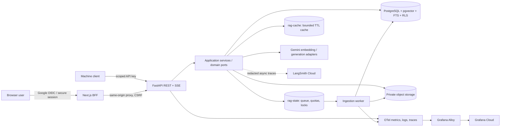
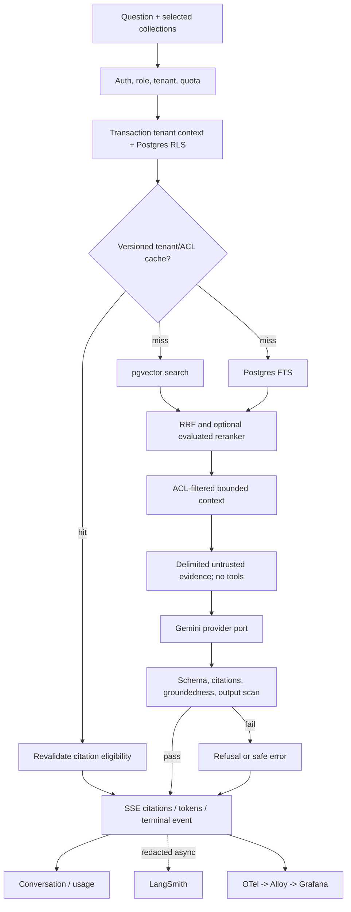
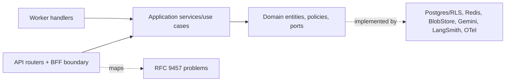
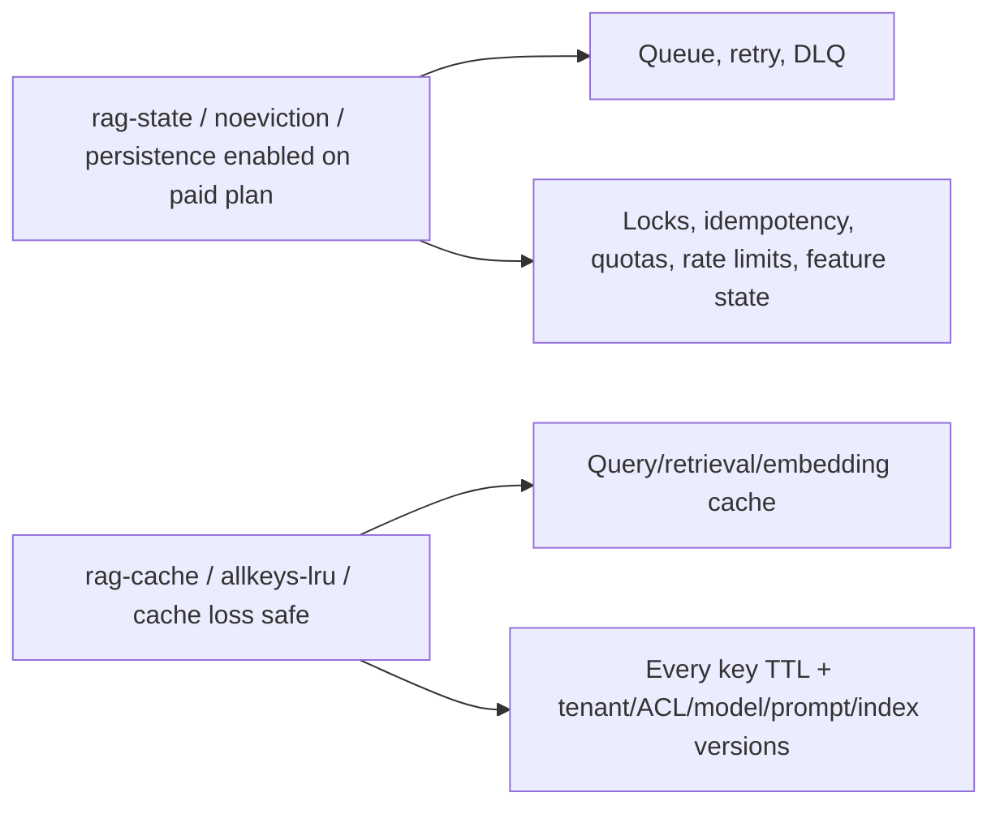
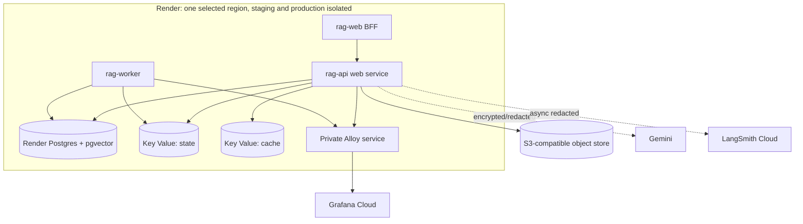
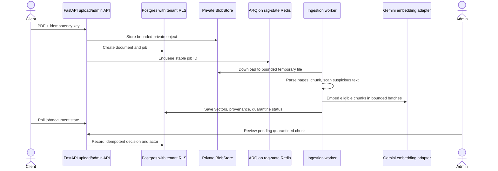

# Architecture

Status: Phase 0 design approved; Milestone 2 implementation map. This file describes the intended full system and identifies M2's delivered pieces; later milestone components are planned until marked implemented.

## Context and containers

The platform serves authenticated users and machine clients across tenant boundaries. Browser traffic is same-origin through a Next.js BFF; machine clients use tenant-scoped API keys. A FastAPI service implements application use cases, an independent worker handles ingestion, and Postgres RLS provides a database-level isolation boundary. Raw files use a private object store. Redis-compatible stores are separated by durability/eviction purpose. External model, tracing and observability providers receive only bounded, redacted data.

## Data flows

### Ingestion

1. Authenticate editor, derive tenant from identity, bind tenant context for RLS.
2. Stream one bounded PDF to temporary/private blob storage; enforce content sniffing, scanning hook and idempotency.
3. Create document and queued job, then enqueue to `rag-state`; return 202.
4. Worker parses and sanitizes text in bounded resources, preserves provenance, checks injection, quarantines suspicious chunks, embeds only eligible content and writes transactionally.
5. Terminal job status and redacted metrics record success/failure. Retries use content hash and job idempotency.

### Query

1. Validate user/session/API key, tenant, collection ACL, quota, query size and conversation access.
2. Check tenant/ACL/model/prompt/index-version cache; revalidate citation eligibility before a cache hit.
3. Run dense vector and PostgreSQL FTS retrieval in RLS/ACL scope, merge with RRF; optional reranker is behind a port and enabled only when evaluation justifies it.
4. Assemble bounded context with per-request delimiters; send no tools, secrets or cross-tenant data to the pinned Gemini model.
5. Validate structured response, citation chunk membership, groundedness and output safety. Refuse if evidence is insufficient. Stream SSE; persist only agreed conversation/query fields.
6. Export redacted trace asynchronously to LangSmith and platform telemetry through OTel/Alloy to Grafana Cloud. Export failure must not hold up user response.

## Boundaries and layering

`domain` imports only the standard library and domain types. Services depend on ports, adapters implement those ports, and routers only validate/authorize/map transport. Tenant-scoped repository calls require explicit transaction context. Migration and runtime DB roles are separate; runtime role cannot bypass RLS or alter schema. These boundaries are targets for import-linter rules and adapter contract tests.

## Data and tenancy

Core records: tenants, users/identity links, hashed API keys, collections, documents, chunks/embeddings, jobs, conversations/messages, feedback, usage/query metadata and audit events. The initial schema implements tenants, users, API keys, idempotency records, collections, documents, chunks, jobs, conversations, messages and query logs. Tenant and user ownership are explicit. RLS is enabled and forced on all 11 tenant-bearing tables; policies use transaction-local `app.tenant_id`. Connection context is scoped to one database transaction. Queries also include explicit tenant filters for performance and defense in depth. Migrations run under a separate role. The vector column intentionally has no declared dimension or HNSW index pending the embedding-model decision; add a measured index in a future owner-approved migration. FTS uses a stored English `tsvector` and GIN index. pgvector documents that approximate index filters can reduce returned matches, so iterative scans or partition/index design require measured tuning.

The runtime database role cannot bypass RLS or alter schema. The local Compose bootstrap uses the separate migration role to create the first tenant and admin key; the API process never receives that privileged URL. The plaintext key is returned once on the operator terminal and the database stores only its SHA-256 digest.

Deletion is an asynchronous operation covering blob, DB rows/chunks/vectors, versioned caches, query-derived records and applicable telemetry deletion/retention. External telemetry must retain only opaque IDs needed for correlation, and the feasibility/timing of provider trace deletion must be confirmed before production.

## Redis responsibilities

Queue writes fail visibly when memory is full; ingestion endpoint returns retryable 503 and queue alerts fire. Cache outage is fail-open and increments a metric. Redis keys are tenant-scoped; no cached answer is shared across ACL contexts. The actual memory plan and maximum queue retention are capacity decisions for implementation.

## Observability and privacy

API and worker emit JSON logs and OTel traces/metrics with request ID, trace ID, build version and tenant pseudonym where allowed. Never use query text, user ID, request ID or document ID as metric labels. Raw prompts, retrieved text, API keys and PII are excluded from external telemetry; tracing uses allowlisted fields and async bounded export. LangSmith is for LLM runs/evals/feedback; Grafana Cloud is for service health, logs, metrics, traces and alerts. Grafana Faro is planned for browser errors/web vitals with message content excluded and identity masked. Every alert links to a runbook.

## Deployment view

Terraform is the infrastructure source of truth. Provider/API capability, service plans, region and secrets are reviewed before any `.tf` implementation. Paid Render Postgres supports backups/PITR according to current docs, with recovery window tied to workspace plan; RPO/RTO remain targets until tested. Paid Key Value persistence and policy are selected separately. No production apply outside owner-approved CI/CD. The web/BFF and API use private service connections where supported; no public DB/Redis ingress.

## Milestone 3 ingestion path

The worker stores only opaque tenant/document/job IDs in logs. PDF extraction runs off the event loop. Queue delivery is at least once; stable job IDs and row-locked finalization keep duplicate jobs safe. Temporary input storage is bounded; the review API returns plain text that the UI must render without HTML interpretation.

## Decisions and trade-offs

See [ADR index](ADR/README.md). Main deliberate trade-offs: REST/SSE is simpler for this bounded UI and client model but streaming cannot resume; Postgres/pgvector reduces data-system count but requires careful tenant-filtered ANN validation; two Redis instances increase cost but separate queue integrity from cache eviction; managed LangSmith/Grafana reduce operations while requiring redaction, retention review and adapter portability; Gemini selection follows owner preference, but exact models, dimensions, region and provider terms remain to confirm.

## NFR to architecture decision mapping

| NFR IDs | Decisions/components that address it | Trade-off / evidence still required |
|---|---|---|
| PERF-001/002, SCALE-001/002 | ADR-001 Postgres/pgvector + FTS; ADR-003 hybrid retrieval; ADR-004 worker/queue; ADR-006 Redis split; ADR-012 un-sized vector column pending model selection | Load test and query plan tuning required; thresholds proposed; HNSW index awaits approved embedding dimension. |
| AVAIL-001, REL-001, OPS-001 | ADR-002 REST/jobs; ADR-004 queue; ADR-010 Render health-gated deployment; timeouts, bounded retries, circuit breakers | Provider outages excluded from latency target; verify failover/rollback. |
| DR-001, DATA-001 | ADR-001 Postgres source of truth; ADR-004 persisted state queue; ADR-005 external blob store; deletion operation | Must run restore and cascade drill; blob backup and retention open. |
| SEC-001..003, AI-001/002 | ADR-007 RLS; ADR-008 no-tool guarded RAG; ADR-009 BFF; ADR-011 redacted telemetry; ADR-012 forced RLS, role split, hashed API keys | Local RLS role smoke passed; CI repeats tenant visibility checks. Red-team tests remain required; no design alone proves zero leakage. |
| PRIV-001 | ADR-011 telemetry minimization; ADR-005 data lifecycle; BFF identity separation | Retention/provider deletion terms need owner confirmation. |
| A11Y-001, UX-001, COMP-001 | ADR-009 Next.js UI and EN/SW localization; WCAG target in NFR | Browser/assistive tech tests required. |
| MAINT-001, TEST-001, PORT-001 | Hexagonal layering, ports, Postgres/Redis adapters, adapter contract tests, OpenAPI source of truth; ADR-012 | M2 static checks and 85% unit coverage passed; full adapter contract coverage and performance verification remain. |
| OBS-001 | ADR-011 OTel/Alloy/Grafana and optional LangSmith | Staging alert exercise and redaction proof required. |
| COST-001 | ADR-008 bounded model/context/token use; quotas, usage accounting, kill switch | Owner budgets absent; provider prices can change. |

## Open risks

- No owner-approved budgets, retention, region, tenant scale or named operations owner.
- Gemini model identity, embedding dimension, data retention, region and SDK integration are not yet verified for the selected account/tier.
- Terraform provider and Render capabilities evolve; current docs are design evidence, not a substitute for re-checking at implementation.
- ANN recall under RLS/ACL filters may require partitioning, iterative scans or exact search; benchmark before setting final target.
- Cloud trace deletion and LangSmith retention/region suitability require a privacy review.
- `localhost` is not a deployable production domain; local-only interpretation is proposed.

