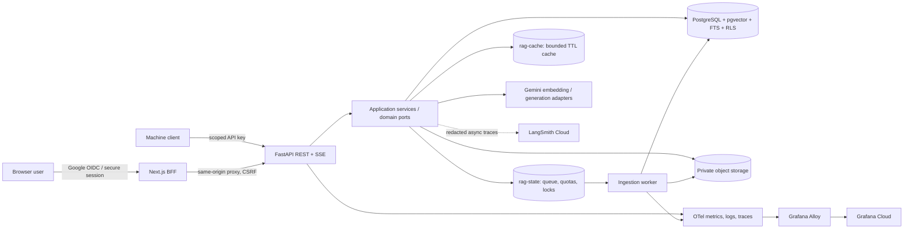
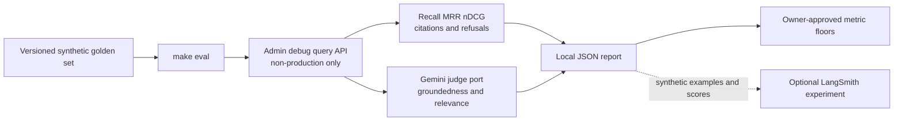
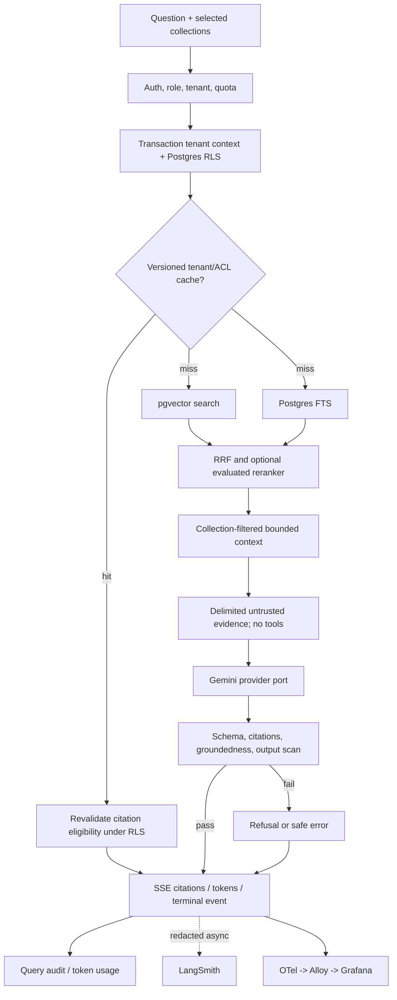
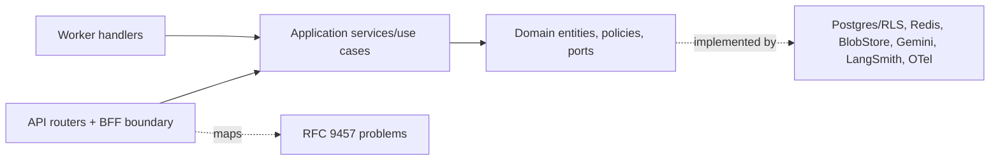
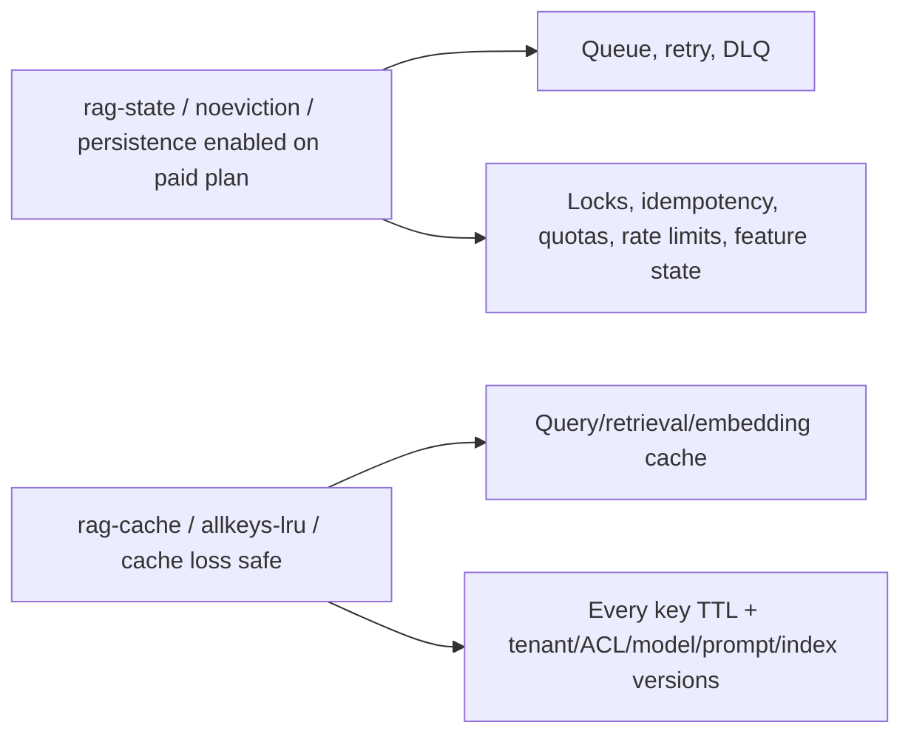
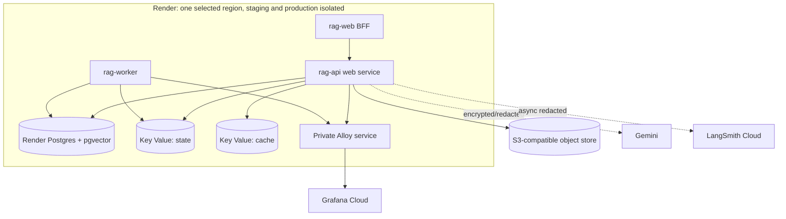
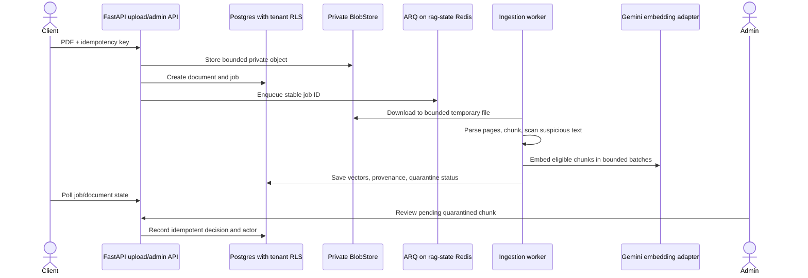

# Architecture

Status: Phase 0 design approved; Milestones 2-5 implementation map. M5 implements redacted request spans, optional metadata-only LangSmith export, query/worker metrics, local Alloy/Prometheus/Grafana wiring, and additional AI security controls. Staging alert exercises, nested LangSmith pipeline spans, and owner privacy/budget gates remain open.

## Context and containers

The platform serves authenticated users and machine clients across tenant boundaries. Browser traffic is same-origin through a Next.js BFF; machine clients use tenant-scoped API keys. A FastAPI service implements application use cases, an independent worker handles ingestion, and Postgres RLS provides a database-level isolation boundary. Raw files use a private object store. Redis-compatible stores are separated by durability/eviction purpose. External model, tracing and observability providers receive only bounded, redacted data.

## Data flows

### Ingestion

1. Authenticate editor, derive tenant from identity, bind tenant context for RLS.
2. Stream one bounded PDF to temporary/private blob storage; enforce content sniffing, scanning hook and idempotency.
3. Create document and queued job, then enqueue to `rag-state`; return 202.
4. Worker parses and sanitizes text in bounded resources, preserves provenance, checks injection, quarantines suspicious chunks, embeds only eligible content and writes transactionally.
5. Terminal job status and redacted metrics record success/failure. Retries use content hash and job idempotency.

### Query

1. Validate user/session/API key, tenant, collection ACL, quota, query size and conversation access.
2. Check tenant/ACL/model/prompt/index-version cache; revalidate citation eligibility before a cache hit.
3. Run dense vector and PostgreSQL FTS retrieval in RLS/ACL scope, merge with RRF; optional reranker is behind a port and enabled only when evaluation justifies it.

### Evaluation (Milestone 6)

1. A local CLI loads the versioned synthetic dataset and calls the existing admin-only debug query endpoint on an explicitly configured non-production collection.
2. Provider-free domain functions score recall@k, MRR, nDCG, citation accuracy and refusal accuracy. An isolated Gemini judge adapter scores groundedness and answer relevance using structured output and bounded timeouts.
3. The CLI writes a local JSON report and, when configured, records the same synthetic run as a LangSmith experiment. Numeric regression floors are owner-approved configuration; unset thresholds record a baseline only.

4. Assemble bounded context with per-request random delimiters; send no tools, secrets or cross-tenant data to the proposed Gemini model.
5. Validate structured claims, citation chunk membership and output safety. Refuse if retrieval is empty or generated claims fail validation. Store request, token counts and retrieved chunk IDs in the tenant-scoped query audit table.
6. Emit `rag.query.v1` events in contract order: retrieval started, verified citations, validated answer chunks or refusal, then one terminal event. Generation completes before answer chunks are emitted to preserve citation validity; TTFT needs staging measurement.
7. M5 adds an OTel HTTP span with request ID, route template and response status. Optional LangSmith run export is asynchronous and metadata-only; it excludes raw prompts, retrieved text, outputs and user identifiers. Alloy scrapes API/worker Prometheus metrics and accepts OTLP traces. Local Prometheus/Grafana dashboards are available through the Compose `observability` profile.

## Boundaries and layering

`domain` imports only the standard library and domain types. Services depend on ports, adapters implement those ports, and routers only validate/authorize/map transport. Tenant-scoped repository calls require explicit transaction context. Migration and runtime DB roles are separate; runtime role cannot bypass RLS or alter schema. These boundaries are targets for import-linter rules and adapter contract tests.

## Data and tenancy

Core records: tenants, users/identity links, hashed API keys, collections, documents, chunks/embeddings, jobs, conversations/messages, feedback, usage/query metadata and audit events. The initial schema implements tenants, users, API keys, idempotency records, collections, documents, chunks, jobs, conversations, messages and query logs. Tenant and user ownership are explicit. RLS is enabled and forced on all 11 tenant-bearing tables; policies use transaction-local `app.tenant_id`. Connection context is scoped to one database transaction. Queries also include explicit tenant filters for performance and defense in depth. Migrations run under a separate role. The vector column intentionally has no declared dimension or HNSW index pending the embedding-model decision; add a measured index in a future owner-approved migration. FTS uses a stored English `tsvector` and GIN index. pgvector documents that approximate index filters can reduce returned matches, so iterative scans or partition/index design require measured tuning.

The runtime database role cannot bypass RLS or alter schema. The local Compose bootstrap uses the separate migration role to create the first tenant and admin key; the API process never receives that privileged URL. The plaintext key is returned once on the operator terminal and the database stores only its SHA-256 digest.

Deletion is an asynchronous operation covering blob, DB rows/chunks/vectors, versioned caches, query-derived records and applicable telemetry deletion/retention. External telemetry must retain only opaque IDs needed for correlation, and the feasibility/timing of provider trace deletion must be confirmed before production.

## Redis responsibilities

Queue writes fail visibly when memory is full; ingestion endpoint returns retryable 503 and queue alerts are provisioned. Query cache outage is fail-open. Cache payloads carry TTL, model/prompt/config version, tenant ID and a tenant epoch; hits revalidate cited chunks against ready documents and permitted quarantine states. Ingestion completion, document deletion and quarantine decisions increment the epoch in `rag-state`. Redis keys are tenant-scoped; no cached answer is shared across tenants. Query-provider circuit breakers, worker outcome counters, query outcome/duration metrics, and tracing export failure metrics are implemented. Redis cache hit/failure metrics and a dedicated Redis outage dashboard remain open.

### Milestone 4 query implementation

The live query path is `src/rag/api/routers/query.py` → `QueryService` → tenant-bound Postgres repository and Gemini provider ports. It uses dense cosine and English FTS search, reciprocal-rank fusion, a bounded context, structured claims and strict citation ID membership. The Redis adapter separates epochs from evictable response payloads. Conversation IDs are accepted but history is not read or written in M4. See [ADR-014](ADR/ADR-014-milestone-4-query-pipeline.md) for proposed defaults, model choice, streaming tradeoff, provider references and open verification gates.

### NFR to architectural decision mapping

| NFR | Satisfying decision/component | Verification |
|---|---|---|
| NFR-PERF-001/002 | ADR-001 pgvector/FTS; ADR-003 RRF; ADR-008 bounded provider calls; ADR-014 candidate cap, context/output limits and async calls | Staging p95 retrieval/TTFT/full answer load test; no M4 performance claim until measured |
| NFR-AI-001 | ADR-003 hybrid retrieval; ADR-008 evidence-grounded no-tool generation; ADR-014 minimum cosine threshold/RRF/refusal; ADR-016 versioned synthetic dataset, retrieval metrics, LLM judge and optional LangSmith experiment | `make eval`; numeric regression gates remain pending owner-approved thresholds |
| NFR-AI-002 | ADR-008 structured generation; ADR-014 claim citation IDs validated against retrieved chunks before response | Invalid citation unit and contract tests |
| NFR-SEC-001/003 | ADR-007 forced RLS plus explicit tenant/collection filters; ADR-014 eligibility rules for ready and clear/approved chunks | Postgres RLS integration checks and cross-tenant query tests |
| NFR-PRIV-001 | ADR-011/015 allowlisted metadata-only telemetry; ADR-014 query data remains in tenant-scoped DB/cache and is not exported | Redaction unit tests; SDK serialized-export integration test, provider retention/deletion review and staging proof remain open |
| NFR-REL-001 | ADR-004 durable state separated from ADR-014 evictable cache; cache read/write failure falls through to query path | Redis fault tests and cache invalidation tests |
| NFR-OPS-001 | ADR-014 bounded provider timeout, circuit breaker, max output tokens, context size and request top-k | Timeout/error tests and staging capacity verification |
| NFR-MAINT-001/TEST-001 | ADR-014 query ports isolate Postgres, Gemini and Redis adapters; API layer depends only on the query port | import-linter, strict mypy, port-contract tests and >=80% coverage |

## Observability and privacy

API and worker emit JSON logs and metrics; API request spans include request/trace IDs, route template and status. Never use query text, user ID, request ID or document ID as metric labels. Raw prompts, retrieved text, API keys and PII are excluded from external telemetry; LangSmith uses allowlisted metadata and an async bounded queue. LangSmith has nested stage envelopes but per-stage timing/feedback is incomplete. Local Grafana dashboards and Prometheus alert rules live in `observability/`; production Grafana Cloud contact points, retention, synthetic canary and log/trace links need deployment configuration. Grafana Faro is planned for browser errors/web vitals with message content excluded and identity masked. Every alert links to a runbook.

## Deployment view

Terraform is the infrastructure source of truth. Provider/API capability, service plans, region and secrets are reviewed before any `.tf` implementation. Paid Render Postgres supports backups/PITR according to current docs, with recovery window tied to workspace plan; RPO/RTO remain targets until tested. Paid Key Value persistence and policy are selected separately. No production apply outside owner-approved CI/CD. The web/BFF and API use private service connections where supported; no public DB/Redis ingress.

## Milestone 3 ingestion path

The worker stores only opaque tenant/document/job IDs in logs. PDF extraction runs off the event loop. Queue delivery is at least once; stable job IDs and row-locked finalization keep duplicate jobs safe. Temporary input storage is bounded; the review API returns plain text that the UI must render without HTML interpretation.

## Decisions and trade-offs

See [ADR index](ADR/README.md). Main deliberate trade-offs: REST/SSE is simpler for this bounded UI and client model but streaming cannot resume; Postgres/pgvector reduces data-system count but requires careful tenant-filtered ANN validation; two Redis instances increase cost but separate queue integrity from cache eviction; managed LangSmith/Grafana reduce operations while requiring redaction, retention review and adapter portability; Gemini selection follows owner preference, but exact models, dimensions, region and provider terms remain to confirm.

## NFR to architecture decision mapping

| NFR IDs | Decisions/components that address it | Trade-off / evidence still required |
|---|---|---|
| PERF-001/002, SCALE-001/002 | ADR-001 Postgres/pgvector + FTS; ADR-003 hybrid retrieval; ADR-004 worker/queue; ADR-006 Redis split; ADR-012 un-sized vector column; ADR-013 upload/page/chunk/batch/concurrency bounds | Load test and query plan tuning required; thresholds proposed; HNSW index awaits approved embedding dimension. |
| AVAIL-001, REL-001, OPS-001 | ADR-002 REST/jobs; ADR-004 queue; ADR-010 Render health-gated deployment; ADR-013 stable job IDs, duplicate-safe persistence and bounded provider retries | Provider outages excluded from latency target; verify failover/rollback. |
| DR-001, DATA-001 | ADR-001 Postgres source of truth; ADR-004 persisted state queue; ADR-005 private blob store; ADR-013 idempotent deletion and metadata redaction | Must run restore and cascade drill; production blob backup and retention open. |
| SEC-001..003, AI-001/002 | ADR-007 RLS; ADR-008 no-tool guarded RAG; ADR-009 BFF; ADR-011 redacted telemetry; ADR-012 forced RLS, role split, hashed API keys; ADR-013 admin-scoped quarantine and audited decisions | Local RLS role smoke passed; CI repeats tenant visibility checks. Red-team tests remain required; no design alone proves zero leakage. |
| PRIV-001 | ADR-011 telemetry minimization; ADR-005 data lifecycle; BFF identity separation | Retention/provider deletion terms need owner confirmation. |
| A11Y-001, UX-001, COMP-001 | ADR-009 Next.js UI and EN/SW localization; WCAG target in NFR | Browser/assistive tech tests required. |
| MAINT-001, TEST-001, PORT-001 | Hexagonal layering, ingestion ports/adapters, Postgres/Redis adapters, OpenAPI source of truth; ADR-012/013 | M3 static checks and 81% branch-aware unit coverage passed; live provider contract coverage and performance verification remain. |
| OBS-001 | ADR-011/015 OTel request spans, bounded Prometheus metrics, worker outcome endpoint, optional content-free LangSmith exporter, Alloy/Grafana local profile | Middleware and exporter tests; full-stage/job trace correlation, cloud alert exercise and missing-telemetry alert remain staging gates. |
| COST-001 | ADR-008 bounded model/context/token use; quotas, usage accounting, kill switch | Owner budgets absent; provider prices can change. |

## Open risks

- No owner-approved budgets, retention, region, tenant scale or named operations owner.
- Gemini model identity, embedding dimension, data retention, region and SDK integration are not yet verified for the selected account/tier.
- Terraform provider and Render capabilities evolve; current docs are design evidence, not a substitute for re-checking at implementation.
- ANN recall under RLS/ACL filters may require partitioning, iterative scans or exact search; benchmark before setting final target.
- Cloud trace deletion and LangSmith retention/region suitability require a privacy review.
- `localhost` is not a deployable production domain; local-only interpretation is proposed.

