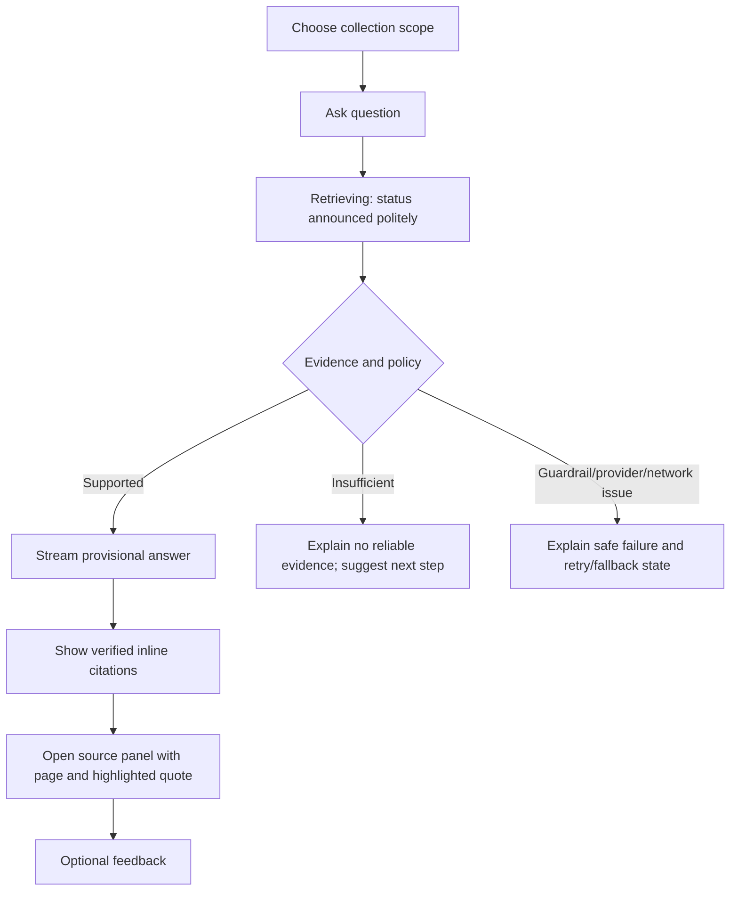

# UX outline

Status: Phase 0 outline; detailed interaction design and implementation belong to Milestone 8. All flows map to [requirements](REQUIREMENTS.md); security and access remain enforced by the API, not the UI alone.

## Personas

| Persona | Need | Primary requirements |
|---|---|---|
| Knowledge user / viewer | Ask a question, trust the answer and inspect source passages | FR-QRY-001..003, FR-CIT-001..002, FR-CNV-001..002, FR-FBK-001, FR-UI-001/002 |
| Knowledge editor | Add, organize and remove PDF knowledge; understand processing failures | FR-ING-001..005, FR-KB-001, FR-UI-003 |
| Tenant administrator | Review quarantined material, manage access and understand usage | FR-ADM-001/002, FR-AUTH-001/003/004, FR-UI-004 |
| Platform operator | Monitor dependencies and investigate incidents with minimal data exposure | FR-STA-001/002, NFR-OBS-001, NFR-OPS-001 |

## Key flows

### Sign-in and session

1. User chooses “Continue with Google”.
2. Server validates OIDC state/nonce and maps approved identity to tenant/role.
3. BFF issues secure HttpOnly same-origin session; browser receives no provider credential.
4. On logout or expiry, BFF invalidates session and UI clears in-memory user data.

### Ask and verify an answer



Requirements: FR-QRY-001..004, FR-CIT-001/002, FR-CNV-001/002, FR-FBK-001, FR-UI-001. A cancel action aborts the stream; token text is marked provisional until the terminal event. Empty evidence, rate limit, quota, retrieval-only fallback and offline states are distinct.

### Upload and maintain knowledge

1. Editor selects a collection and drops one or more PDFs.
2. UI checks known type/size locally; server remains authoritative and streams each upload.
3. Each file shows queued → processing → ready/failed, stage and safe error; retry only appears for retryable failures.
4. Document list supports search/filter/status; delete requires confirmation and displays cascade operation status.
5. Collection management allows create/rename/delete with impact confirmation.

Requirements: FR-ING-001..005, FR-KB-001, FR-UI-003. No UI claims completion until server job reports terminal state.

### Admin quarantine review

1. Admin opens tenant-scoped review queue.
2. Suspicious source appears as escaped plain text with document/page, reason codes and provenance.
3. Admin records approve/reject and reason; UI confirms decision and audit timestamp.

Requirements: FR-ING-003, FR-ADM-001, FR-UI-004. Plain-text display has no Markdown/HTML interpretation.

### Usage and settings

Admin selects bounded date range for estimated usage/cost, with clear estimate label and quota context. User settings include locale EN/SW, theme light/dark/system, session/logout, and retention information. No conversations, tokens or secrets are stored in localStorage; only non-sensitive preferences may persist.

Requirements: FR-ADM-002, FR-USG-001, FR-UI-002/004.

## Interaction principles and accessibility targets

- English and Swahili externalized strings from first UI milestone; localize dates/numbers and accommodate longer labels.
- Keyboard-first navigation, visible focus, semantic controls and labels; screen reader live region announces state changes and completed chunks politely, not every token.
- Contrast and status are not conveyed by color alone. Reduced-motion preference respected.
- Mobile-first responsive layout; citations panel becomes a bottom sheet on narrow screens; touch targets and composer remain usable with the on-screen keyboard.
- Light, dark and system themes share documented tokens. Model output is rendered through a strict safe Markdown allowlist; no raw HTML, images or automatic remote content.

## Visual structure (concept only)

```text
Desktop: [conversation history] [message stream + sticky composer] [citation detail panel]
Mobile:  [history drawer] [message stream + sticky composer] [citation bottom sheet]
Knowledge: [collection selector] [search/filter + document table] [upload panel/job progress]
Admin: [review queue] [plain-text detail + decision] [usage/status tabs]
```

## Design tokens to define in Milestone 8

Use semantic tokens rather than component-specific values: background/surface/raised surface, foreground/muted text, primary/accent, success/warning/error/info, border/focus ring; body and display type scale; 4/8-based spacing; restrained radii and elevation; motion duration/easing plus reduced-motion override. Exact values and final typography remain pending visual exploration and owner review.

## Verification planned

Playwright flows cover Google login/session, upload/status, streaming citations, refusal, feedback, admin quarantine and mobile viewport. axe and Lighthouse budgets target WCAG 2.2 AA and accessibility ≥90. XSS tests cover HTML/script, Markdown images, unsafe link schemes and remote loads. These tests are future evidence, not completed in Phase 0.

